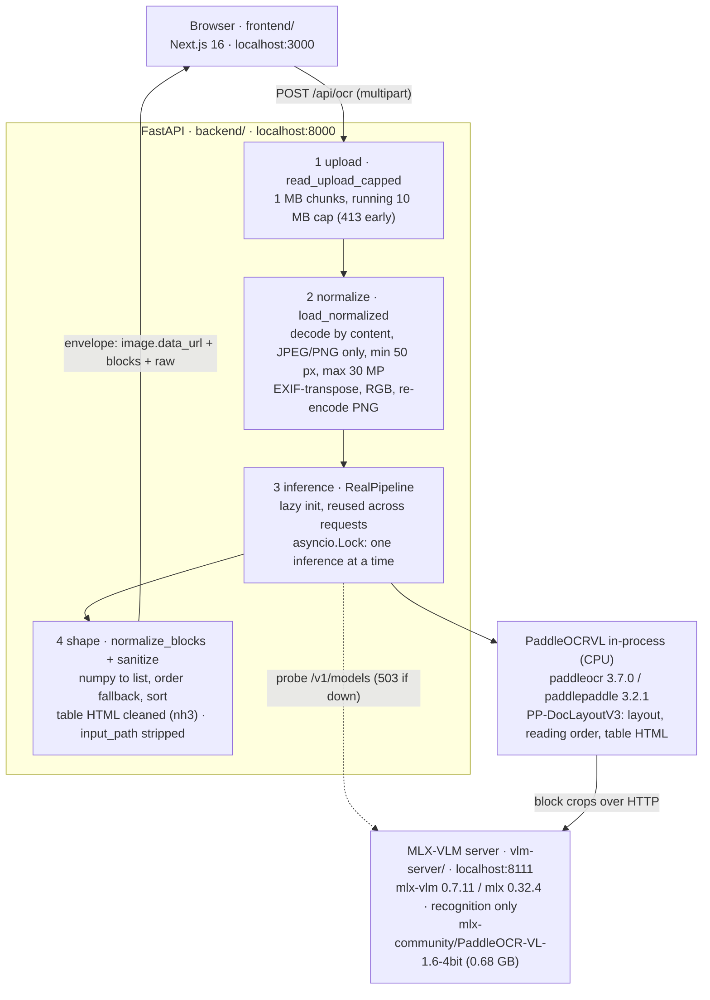

# Invoice OCR Viewer

Local-first invoice/receipt OCR demo for Apple Silicon Macs. Upload an image, run the
full PaddleOCR-VL pipeline (layout analysis on CPU + recognition via MLX on GPU),
inspect recognized blocks with bidirectional selection between the document image and
the reading-order list, and download the raw inference JSON.

All inference runs locally. No cloud APIs, no auth, no database.

## Architecture

Three local processes. `scripts/dev.sh` starts all of them (and refuses to start
if any of their ports is already taken).



The MLX-VLM server handles recognition only. The full pipeline (layout, reading
order, table structuring) runs in the backend via `PaddleOCRVL`, which calls the
server with `vl_rec_backend="mlx-vlm-server"`.

### Coordinate guarantee

`block_bbox` values are pixels of the exact PNG that inference ran on: the
backend EXIF-normalizes and re-encodes first, gives those bytes to the pipeline,
and returns the same bytes as `image.data_url`. The frontend draws one SVG with
`viewBox="0 0 width height"` absolutely positioned over that ``, so boxes
stay aligned at any rendered size - no pixel math, no resize handling.

### Response contract

Every endpoint returns one envelope. `POST /api/ocr` on success:

```json
{ "success": true,
  "data": {
    "image":   { "width": 1240, "height": 1600, "mime": "image/png", "data_url": "..." },
    "blocks":  [ { "id": 0, "order": 0, "label": "table",
                   "bbox": [78, 498, 1171, 916],
                   "content": "<table>...</table>",
                   "content_html": "<table>...</table>" } ],
    "markdown": "...",
    "raw":     { "parsing_res_list": [...], "layout_det_res": [...] } },
  "error": null,
  "meta": { "elapsed_ms": 20601, "model": "mlx-community/PaddleOCR-VL-1.6-4bit", "mode": "real" } }
```

- `id` is the pipeline `block_id` - the stable key for left/right selection sync
  (never text matching; documents can repeat text).
- `order` falls back to `block_id` when `block_order` is null (header/table/footer).
- `content_html` exists only for table blocks, after server-side nh3 sanitization.
  All other block text is rendered as React text nodes (escaped).
- `raw` is the untouched pipeline result minus `input_path` (temp-file path).
  Download JSON in the UI writes exactly this object.

Error envelope: `{ "success": false, "data": null, "error": { "code", "message" } }`.

| HTTP | code | when |
| ---- | ---- | ---- |
| 400 | `undecodable` / `unsupported_format` / `too_small` / `too_many_pixels` | upload fails validation |
| 413 | `file_too_large` | over 10 MB, caught while streaming |
| 422 | `invalid_request` | missing `file` multipart field |
| 503 | `vlm_server_unreachable` / `pipeline_unavailable` / `pipeline_init_failed` | model side not runnable |
| 500 | `inference_failed` / `normalization_failed` | pipeline error or malformed output |
| - | `timeout` / `network_error` | client-side (fetch failed or 5 min cap) |

### Configuration

| Variable | Default | Used by |
| -------- | ------- | ------- |
| `VLM_SERVER_URL` | `http://localhost:8111/` | backend: where PaddleOCRVL sends recognition |
| `VLM_MODEL_NAME` | `mlx-community/PaddleOCR-VL-1.6-4bit` | backend: model name passed to the server |
| `OCR_BACKEND` | `real` | backend: `stub` returns deterministic fake results, no model |
| `NEXT_PUBLIC_API_BASE` | `http://localhost:8000` | frontend: API base URL |

CORS allows only `localhost:3000` / `127.0.0.1:3000`.

### Repository layout

```
backend/     FastAPI app: main.py (routes), images.py (validation/EXIF),
             pipeline.py (real + stub backends), blocks.py (normalize/sanitize),
             schemas.py (envelope), config.py; tests/ (pytest, stub-only)
vlm-server/  uv project holding only mlx-vlm (isolated from paddle deps)
frontend/    Next.js app: app/page.tsx (state machine),
             components/ocr-viewer/ (UploadPanel, ImagePane+SVG overlay,
             BlockList, StatusBar, ErrorBanner), lib/ (api, types, blocks)
scripts/     dev.sh, make_sample_invoice.py, run_real_inference.py,
             eval_dataset.py
e2e/         Playwright specs against a mocked /api/ocr
docs/        VALIDATION.md (real-inference log), eval_summary.json (booleans)
samples/     our own PIL-generated test invoice (committable)
```

## Requirements

- Apple Silicon Mac (tested: M2, 16 GB, macOS)
- [uv](https://docs.astral.sh/uv/) 0.13+
- Node.js 20+ (tested: 26) with npm
- ~1 GB disk for models (0.68 GB VLM + PP-DocLayoutV3), internet on first run

## Setup

```bash
uv sync --project backend      # FastAPI + paddleocr[doc-parser] + paddlepaddle 3.2.1 (CPU)
uv sync --project vlm-server   # mlx-vlm
cd frontend && npm install && cd ..
```

Locked dependency versions live in `backend/uv.lock` and `vlm-server/uv.lock`
(key pins: paddleocr 3.7.0, paddlepaddle 3.2.1, mlx-vlm 0.7.11, mlx 0.32.4,
fastapi 0.162.0, Next.js 16.4.3).

## Run

```bash
scripts/dev.sh        # starts all three services, logs in /tmp/invoice-ocr-*.log
```

Or manually:

```bash
uv run --project vlm-server mlx_vlm.server --port 8111 --model mlx-community/PaddleOCR-VL-1.6-4bit
(cd backend && uv run uvicorn app.main:app --port 8000)
cd frontend && npm run dev
```

The first VLM server start downloads the 4-bit model (0.68 GB). The first OCR
request additionally downloads the PP-DocLayoutV3 layout model and initializes the
pipeline (~20 s one-time). Open http://localhost:3000.

Health check: `curl localhost:8000/api/health` (reports whether the VLM server is
reachable).

Frontend work without any model: start only the API in stub mode - it returns
deterministic fake blocks and needs neither the MLX server nor the layout model:

```bash
(cd backend && OCR_BACKEND=stub uv run uvicorn app.main:app --port 8000)
```

## Usage

1. Drop or choose a JPG/PNG (max 10 MB, 30 MP, min 50 px side).
2. Press Run OCR. Real inference takes roughly 15-20 s per page on an M2.
3. Left: document with region boxes. Right: blocks in reading order.
   Click either side to select; arrows or j / k step through blocks; Esc clears.
   Table blocks render as sanitized HTML with a source toggle.
4. Download JSON returns the raw pipeline result (`parsing_res_list`,
   `layout_det_res`, dimensions).

## Tests

```bash
uv run --project backend pytest          # unit/API tests, stub backend, no model
uv run --project backend ruff check app tests
cd frontend && npm test                  # vitest unit tests
cd frontend && npm run e2e               # Playwright against mocked API
```

Live-model checks (require the services above, never part of pytest):

```bash
uv run --project backend python scripts/run_real_inference.py samples/invoice_sample.png
uv run --project backend python scripts/eval_dataset.py   # after fetching samples, see below
```

Results and timings are recorded in `docs/VALIDATION.md`.

## Dataset samples (optional eval only)

`eval_samples/` is gitignored. A few images can be fetched from
[mychen76/invoices-and-receipts_ocr_v1](https://huggingface.co/datasets/mychen76/invoices-and-receipts_ocr_v1)
via the HF datasets-server rows API (see `scripts/eval_dataset.py`). The dataset
has no license declared, so its images are never committed or redistributed;
stored annotations are used only as a labeled reference (`ast.literal_eval`, never
`eval`).

## Known limitations (v1)

- Layout blocks only; no per-word boxes, no business-field extraction.
- `block_order` is null for some layout classes (header/table/footer); the viewer
  falls back to pipeline order for those.
- Single image per run; no PDF/multi-page/batch.
- English/Latin documents tested; CJK not exercised end-to-end yet.
- The processing state shows elapsed time only - no progress percentage exists.
- First inference after boot pays one-time model init (~20 s).
- If the VLM server is down, requests fail with `vlm_server_unreachable` (503);
  nothing is cached between runs.
- Error messages may include underlying library exception text - fine for a
  localhost demo, not for exposing beyond loopback.
