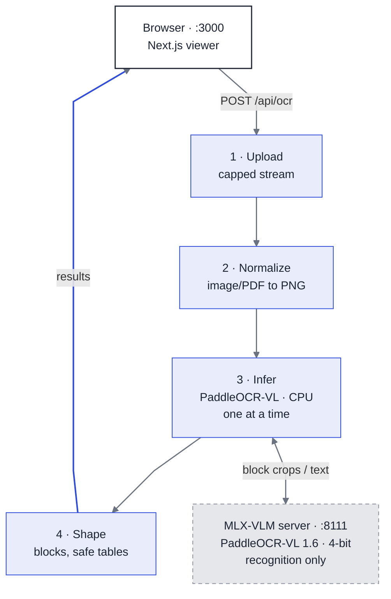

# Invoice OCR Viewer

Local-first invoice/receipt OCR demo for Apple Silicon Macs. Upload an image or a
PDF (up to 8 pages), run the full PaddleOCR-VL pipeline (layout analysis on CPU +
recognition via MLX on GPU), inspect recognized blocks with bidirectional selection
between the document image and the reading-order list, and download the raw
inference JSON. Tables that continue onto the next PDF page are merged into one
block spanning both pages.

All inference runs locally. No cloud APIs, no auth. Persistence is optional:
with `DATABASE_URL` set, every run is stored in local Postgres and can be
reopened from a history strip (see below); without it the app stays stateless.

## Architecture

An annotated one-page version of this section: [`docs/architecture.html`](docs/architecture.html)
(open directly in a browser - self-contained, no server needed), also exported to
[`docs/architecture.pdf`](docs/architecture.pdf) (A4, 3 pages, natural size;
regenerate with `node scripts/export_architecture_pdf.mjs`).

Three local processes. `scripts/dev.sh` starts all of them (and refuses to start
if any of their ports is already taken).



Legend: blue = the four stages inside the FastAPI backend (`backend/`,
:8000); dashed gray = the one separate process it talks to. Layout
(PP-DocLayoutV3) runs in-process on CPU, so it is part of stage 3, not a
separate box.

Stage detail (numbers match the diagram):

1. `read_upload_capped` - streams the body in 1 MB chunks with a running 10 MB
   cap, so oversize uploads fail with 413 before being buffered.
2. `load_normalized` - decodes by content (JPEG/PNG only, min 50 px side,
   max 30 MP), EXIF-transposes, converts to RGB, re-encodes as PNG. PDF
   uploads (`render_pdf_pages`) are instead rendered page by page at 150 DPI
   with pypdfium2 (max 8 pages); each page then follows the same path.
3. `RealPipeline` - probes the MLX server (`/v1/models`, 503 if down), then
   runs PaddleOCRVL (PP-DocLayoutV3 layout on CPU, recognition delegated to the
   MLX server): lazy init, reused across requests; an asyncio.Lock allows one
   inference at a time; temp files deleted in finally. Multi-page documents
   run once per page, then `restructure_pages(merge_tables=True)` merges
   tables that continue on the next page (engine feature, MinerU-derived).
4. `normalize_blocks` / `normalize_document` - numpy arrays to lists, order
   falls back to `block_id`, blocks sorted; table HTML sanitized (nh3);
   `input_path` stripped. Multi-page: each block carries its `page`; a merged
   table keeps one list entry with `page_end` and per-page `page_bboxes`
   (the emptied continuation fragment is not emitted).

The MLX-VLM server handles recognition only. The full pipeline (layout, reading
order, table structuring) runs in the backend via `PaddleOCRVL`, which calls the
server with `vl_rec_backend="mlx-vlm-server"`.

### Coordinate guarantee

`block_bbox` values are pixels of the exact PNG that inference ran on: the
backend EXIF-normalizes and re-encodes first (or renders the PDF page itself),
gives those bytes to the pipeline, and returns the same bytes as that page's
`data_url`. The frontend draws one SVG with `viewBox="0 0 width height"`
absolutely positioned over each page's ``, so boxes stay aligned at any
rendered size - no pixel math, no resize handling.

### Response contract

Every endpoint returns one envelope. `POST /api/ocr` on success:

```json
{ "success": true,
  "data": {
    "pages":   [ { "index": 0, "width": 1240, "height": 1600, "mime": "image/png", "data_url": "..." } ],
    "blocks":  [ { "id": 0, "order": 0, "label": "table",
                   "bbox": [78, 498, 1171, 916],
                   "content": "<table>...</table>",
                   "content_html": "<table>...</table>",
                   "page": 0, "page_end": 0, "page_bboxes": null } ],
    "markdown": "...",
    "raw":     { "parsing_res_list": [...], "layout_det_res": [...] } },
  "error": null,
  "meta": { "elapsed_ms": 20601, "model": "mlx-community/PaddleOCR-VL-1.6-4bit",
            "mode": "real", "page_count": 1 } }
```

- `id` is the pipeline `block_id` (multi-page: the engine's global id, unique
  across pages) - the stable key for left/right selection sync
  (never text matching; documents can repeat text).
- `order` falls back to `block_id` when `block_order` is null (header/table/footer).
- `page` / `page_end` locate the block; `page_end > page` marks a table merged
  across pages, with `page_bboxes` holding one bbox per page (owner first).
- `content_html` exists only for table blocks, after server-side nh3 sanitization.
  All other block text is rendered as React text nodes (escaped).
- `raw` is the untouched pipeline result minus `input_path` (temp-file path);
  multi-page documents return `{ "page_count": N, "pages": [per-page results] }`.
  Download JSON in the UI writes exactly this object.

Error envelope: `{ "success": false, "data": null, "error": { "code", "message" } }`.

| HTTP | code | when |
| ---- | ---- | ---- |
| 400 | `undecodable` / `unsupported_format` / `too_small` / `too_many_pixels` / `too_many_pages` | upload fails validation |
| 413 | `file_too_large` | over 10 MB, caught while streaming |
| 422 | `invalid_request` | missing `file` multipart field |
| 503 | `vlm_server_unreachable` / `pipeline_unavailable` / `pipeline_init_failed` | model side not runnable |
| 500 | `inference_failed` / `normalization_failed` | pipeline error or malformed output |
| - | `timeout` / `network_error` | client-side (fetch failed or 5 min cap) |

### Configuration

| Variable | Default | Used by |
| -------- | ------- | ------- |
| `VLM_SERVER_URL` | `http://localhost:8111/` | backend: where PaddleOCRVL sends recognition |
| `VLM_MODEL_NAME` | `mlx-community/PaddleOCR-VL-1.6-4bit` | backend: model name passed to the server |
| `OCR_BACKEND` | `real` | backend: `stub` returns deterministic fake results, no model |
| `NEXT_PUBLIC_API_BASE` | `http://localhost:8000` | frontend: API base URL |
| `DATABASE_URL` | _(unset)_ | backend: Postgres for persistence; unset = stateless, history hidden |
| `DATA_DIR` | `<repo>/data` | backend: where page PNGs are written (DB stores paths only) |

CORS allows only `localhost:3000` / `127.0.0.1:3000`.

### Optional: Postgres persistence

Without `DATABASE_URL` the app is exactly the stateless v1 (no DB needed).
With it, every successful OCR run is stored (documents + pages + blocks) and a
"Recent" strip in the UI can reopen any stored document:

```bash
brew install postgresql@17 && brew services start postgresql@17
createdb invoice_ocr
DATABASE_URL="postgresql://localhost/invoice_ocr" uv run uvicorn app.main:app --port 8000
```

- Schema is applied automatically on first use (`backend/app/schema.sql`, idempotent)
- Page images live under `DATA_DIR/documents/<id>/`; the DB stores paths only
- New endpoints: `GET /api/documents` (list) and `GET /api/documents/{id}`
  (same data shape as `POST /api/ocr`, so the viewer renders stored documents
  with the identical components)
- A persistence failure never discards an OCR result: the response still
  succeeds and `meta.persistence = "failed"` marks it
- No ORM by decision: the whole path is four fixed statements and the pipeline
  already yields dicts; `doc_type`/`extracted` stay JSONB so new document
  types need no DDL

### Repository layout

```
backend/     FastAPI app: main.py (routes), images.py (validation/EXIF/PDF),
             pipeline.py (real + stub backends), blocks.py (normalize/sanitize),
             db.py + schema.sql (optional Postgres persistence), schemas.py
             (envelope), config.py; tests/ (pytest, stub-only + gated SQL tests)
vlm-server/  uv project holding only mlx-vlm (isolated from paddle deps)
frontend/    Next.js app: app/page.tsx (state machine),
             components/ocr-viewer/ (UploadPanel, ImagePane+SVG overlay,
             BlockList, StatusBar, ErrorBanner, HistoryStrip), lib/ (api, types, blocks)
scripts/     dev.sh, make_sample_invoice.py, make_multi_page_invoice.py,
             run_real_inference.py, eval_dataset.py
e2e/         Playwright specs against a mocked /api/ocr and /api/documents
docs/        VALIDATION.md (real-inference log), eval_summary.json (booleans)
samples/     our own PIL-generated test invoice (committable)
data/        gitignored; persisted page PNGs (DB stores paths only)
```

## Requirements

- Apple Silicon Mac (tested: M2, 16 GB, macOS)
- [uv](https://docs.astral.sh/uv/) 0.13+
- Node.js 20+ (tested: 26) with npm
- ~1 GB disk for models (0.68 GB VLM + PP-DocLayoutV3), internet on first run

## Setup

```bash
uv sync --project backend      # FastAPI + paddleocr[doc-parser] + paddlepaddle 3.2.1 (CPU)
uv sync --project vlm-server   # mlx-vlm
cd frontend && npm install && cd ..
```

Locked dependency versions live in `backend/uv.lock` and `vlm-server/uv.lock`
(key pins: paddleocr 3.7.0, paddlepaddle 3.2.1, mlx-vlm 0.7.11, mlx 0.32.4,
fastapi 0.162.0, Next.js 16.4.3).

## Run

```bash
scripts/dev.sh        # starts all three services, logs in /tmp/invoice-ocr-*.log
```

Or manually:

```bash
uv run --project vlm-server mlx_vlm.server --port 8111 --model mlx-community/PaddleOCR-VL-1.6-4bit
(cd backend && uv run uvicorn app.main:app --port 8000)
cd frontend && npm run dev
```

The first VLM server start downloads the 4-bit model (0.68 GB). The first OCR
request additionally downloads the PP-DocLayoutV3 layout model and initializes the
pipeline (~20 s one-time). Open http://localhost:3000.

Health check: `curl localhost:8000/api/health` (reports whether the VLM server is
reachable).

Frontend work without any model: start only the API in stub mode - it returns
deterministic fake blocks and needs neither the MLX server nor the layout model:

```bash
(cd backend && OCR_BACKEND=stub uv run uvicorn app.main:app --port 8000)
```

## Usage

1. Drop or choose a JPG/PNG (max 10 MB, 30 MP, min 50 px side) or a PDF
   (max 10 MB, up to 8 pages, rendered at 150 DPI).
2. Press Run OCR. Real inference takes roughly 15-20 s per page on an M2;
   multi-page documents run once per page, so a 5-page PDF takes ~1.5-2 min.
3. Left: document pages with region boxes. Right: blocks in reading order,
   tagged p.1, p.2, ... (a table merged across pages shows p.1-2 and its
   continuation page draws a dashed box). Click either side to select;
   arrows or j / k step through blocks; Esc clears. Table blocks render as
   sanitized HTML with a source toggle.
4. With persistence on, a Recent strip under the header lists stored
   documents; clicking one reopens it exactly as it was first rendered.
5. Every run is classified by keyword rules (invoice / receipt /
   purchase_order / unknown, from heading-class and leading text blocks);
   the status bar shows the type plus any OCR quality flags (garbled text,
   sparse blocks, ragged tables), and common fields (invoice number, dates,
   subtotal/tax/total) are extracted by regex with arithmetic checks
   (subtotal - discount + shipping + tax == total; bad sums mark fields
   needs_review; amounts are never auto-corrected). Flags are advisory.
   Recognition noise can hide keywords (measured on real samples; see
   docs/VALIDATION.md).
6. Review flow (stored documents only): select a non-table block, press
   "correct", edit the text, save - the correction is stored
   (`corrected_content` + `reviewed_at`) and the block is marked reviewed;
   corrected text replaces the OCR text on every later read. Table blocks
   carry model-generated HTML and are not hand-editable.
7. Download JSON returns the raw pipeline result (`parsing_res_list`,
   `layout_det_res`, dimensions; multi-page wrapped in `pages`).

## Tests

```bash
uv run --project backend pytest          # unit/API tests, stub backend, no model
uv run --project backend ruff check app tests
cd frontend && npm test                  # vitest unit tests
cd frontend && npm run e2e               # Playwright against mocked API

# opt-in SQL round-trip tests against a local Postgres (5 tests skip without it)
TEST_DATABASE_URL="postgresql://localhost/invoice_ocr" uv run --project backend pytest
```

Live-model checks (require the services above, never part of pytest):

```bash
uv run --project backend python scripts/run_real_inference.py samples/invoice_sample.png
uv run --project backend python scripts/eval_dataset.py   # after fetching samples, see below
```

Results and timings are recorded in `docs/VALIDATION.md`.

## Dataset samples (optional eval only)

`eval_samples/` is gitignored. A few images can be fetched from
[mychen76/invoices-and-receipts_ocr_v1](https://huggingface.co/datasets/mychen76/invoices-and-receipts_ocr_v1)
via the HF datasets-server rows API (see `scripts/eval_dataset.py`). The dataset
has no license declared, so its images are never committed or redistributed;
stored annotations are used only as a labeled reference (`ast.literal_eval`, never
`eval`).

## Known limitations (v1)

- Layout blocks only; no per-word boxes, no business-field extraction yet
  (doc-type classification and quality flags exist; field extraction is the
  next phase).
- Classification is keyword-based: a document whose self-identifying word is
  misread by OCR (observed on one sample) or absent falls to `unknown`.
- Quality heuristics are Latin-script-centric; CJK garble does not trip the
  alphanumeric-ratio check.
- `block_order` is null for some layout classes (header/table/footer); the viewer
  falls back to pipeline order for those.
- One document per run; PDFs are capped at 8 pages (inference is ~15-20 s per
  page; larger PDFs must be split first).
- Cross-page table merging is heuristic (widths within 10%, neighbor-block
  classes, matching columns): conservative - a continued table whose next page
  starts with unrelated text above it will not merge.
- English/Latin documents tested; CJK not exercised end-to-end yet.
- The processing state shows elapsed time only - no progress percentage exists.
- First inference after boot pays one-time model init (~20 s).
- If the VLM server is down, requests fail with `vlm_server_unreachable` (503);
  nothing is cached between runs.
- Error messages may include underlying library exception text - fine for a
  localhost demo, not for exposing beyond loopback.
